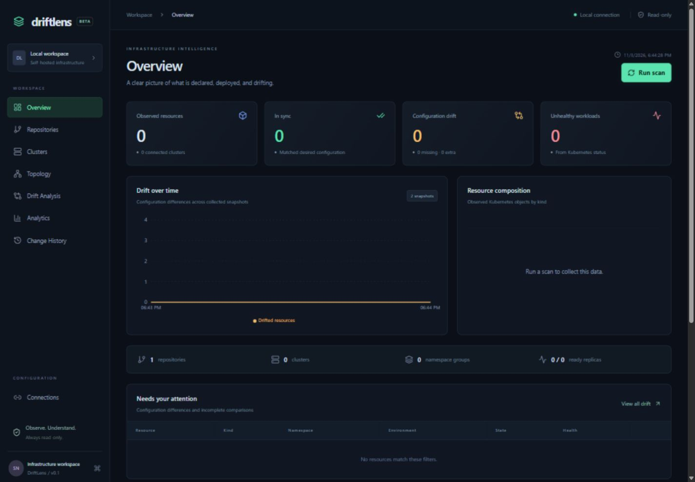

# DriftLens

**Infrastructure, in focus.** A self-hosted, read-only Kubernetes inventory and Git-to-cluster drift intelligence application.

DriftLens renders real Helm charts, reads real Kubernetes resources, compares their structure, and stores observations in SQLite. The interface starts empty until you connect sources; there is no simulated infrastructure or fabricated history.

## What is implemented

- React + TypeScript + Vite + Tailwind, TanStack Query, Recharts, React Flow and Lucide.
- Modular Go REST service with client-go discovery/dynamic clients, Helm CLI, yaml.v3 and SQLite.
- HTTPS/SSH Git repositories, server-side private Git credentials, and restricted local repositories.
- Chart/tree discovery, explicit ordered values files, raw manifest directories, configurable Helm capabilities.
- Multiple clusters with kubeconfig files kept on the self-hosted server. Secret requests use the Kubernetes metadata API; Secret payloads are never persisted or returned.
- Explicit repository/environment/release/namespace/cluster mappings.
- Structural drift: `IN_SYNC`, `MODIFIED`, `MISSING`, `EXTRA`, `UNKNOWN`; field paths, source information and side-by-side YAML.
- Kubernetes-generated metadata normalization, common defaults, keyed Kubernetes lists, configurable JSON-pointer ignores.
- Reference/selector-based topology; inventory includes workloads, Pods, Services, Ingresses, ConfigMaps, PVCs, namespaces, nodes, events and discovered APIs.
- Periodic snapshots, scan history, health transitions, drift trends, resource distributions and Server-Sent Events.
- All eight pages: Overview, Repositories, Clusters, Topology, Drift Analysis, Analytics, Change History and Connections.



## Start locally

Prerequisites: Go 1.25+, Node 22.12+, Git, Helm 3.19+ (also tested locally with Helm 4), Python 3.10+. Kind and Docker are only needed for the cluster demo. The application itself can run without Docker.

**PowerShell**

```powershell
git clone https://github.com/shankarn-monkci/driftlens.git
cd driftlens
powershell -ExecutionPolicy Bypass -File scripts/dev.ps1
```

**Linux/macOS**

```sh
git clone https://github.com/shankarn-monkci/driftlens.git
cd driftlens
make dev
```

Open **http://127.0.0.1:8080**. The launcher creates a random API token in the ignored `.env` file. Copy `DRIFTLENS_API_TOKEN` from that file into the login field. The token is retained in the current browser tab’s session, never in the URL.

The launcher builds the frontend and serves it through Go. For hot reloading, keep the backend running and use `cd frontend && npm run dev` in another terminal; Vite proxies `/api` to Go. Set server configuration before starting the backend; `.env` is loaded by the launch scripts, not automatically by the Go binary.

## Docker Compose

```sh
python scripts/init-env.py
docker compose --env-file .env -f deployments/docker-compose.yml up --build -d
```

Open http://127.0.0.1:8080. SQLite uses a named volume. Backend and frontend run as non-root users; the backend has a read-only root filesystem and read-only source/credential mounts. Both services have health checks. The API token is mandatory for container operation.

For real repositories, adjust the read-only `/repositories` mount. Put kubeconfigs under `credentials/`. On Linux, the container UID `10001` must be able to read those files; for example, set the directory group to `10001` with mode `0750`, and kubeconfig group to `10001` with mode `0640`. Do not make credentials world-readable. Windows Docker Desktop handles host mount permissions differently.

For private Git, mount a trusted SSH configuration/agent or provision a credential helper in your deployment. Credentials in repository URLs are rejected. Do not mount a personal SSH directory indiscriminately.

## Connect infrastructure

1. **Connections → Repository:** add a public HTTPS URL, `ssh://git@host/repo.git`, or a path inside `DRIFTLENS_REPOSITORY_ROOT`. Use **Test** or **Repositories → Discover files**.
2. **Connections → Cluster:** place a kubeconfig in `DRIFTLENS_CREDENTIAL_ROOT` and enter its filename and optional context. Prefer embedded CA/token/certificate data. File references must remain inside the credential root. Use non-production, read-only credentials.
3. **Connections → Environment:** select repository and cluster, chart path, release and namespace. Enter additional values files one per line, in the intended merge order. The chart’s `values.yaml` is already loaded by Helm.
4. **Run scan.** Inspect errors, drift, topology and history. Configure a polling interval of at least 30 seconds, or `0` for manual scans.

No Kubernetes write operations occur in the application. The demo scripts intentionally mutate only the named disposable demo cluster.

## Real Kind demo

Install [Kind](https://kind.sigs.k8s.io/docs/user/quick-start/) and kubectl, and start Docker. Run these commands from the repository root with the application running:

```sh
python scripts/demo.py up
python scripts/demo.py connect
python scripts/demo.py verify --expect sync
python scripts/demo.py drift
python scripts/demo.py verify --expect drift
```

The same commands work in PowerShell; on systems where Python is named `python3`, substitute that command. For a Compose application, use `python scripts/demo.py connect --docker`, which selects the host-reachable kubeconfig. With rootful Docker on Linux, the Kind API may also require an explicitly reachable bind address; see [hosting notes](docs/hosting.md).

The chart contains API and frontend Deployments, Redis StatefulSet, three Services, a ConfigMap and Ingress. The demo verifies:

| Scenario | Expected observation |
| --- | --- |
| API replicas changed from 3 to 1 | `MODIFIED`, `/spec/replicas`, desired `3`, actual `1` |
| ConfigMap deleted | `MISSING` |
| Standalone ConfigMap created | `EXTRA`, unmanaged |
| Frontend image replaced with a nonexistent tag | Image field `MODIFIED` |
| Incomplete frontend rollout | `Degraded` deployment health |

```sh
python scripts/demo.py reset       # Restore chart and remove the extra ConfigMap
python scripts/demo.py scan        # Observe reset after workloads settle
python scripts/demo.py down        # Delete only driftlens-demo
```

The demo’s application token is short-lived (requested for 24 hours); rerun `up` to refresh it. The admin kubeconfig used to create the demo stays in ignored `.data/`. The application connects with the separate read-only kubeconfig. Kubernetes RBAC does not distinguish Secret metadata access from Secret payload access; the demo role grants read/list, while the application deliberately requests metadata only. Scope production roles to the required resource types and namespaces.

## Tests and builds

```sh
cd backend
go test ./...
go vet ./...
go build ./cmd/server
cd ../frontend
npm ci
npm test
npm run build
npm audit
```

`make test`, `make build`, `make demo-up` and `make demo-down` provide equivalents on systems with Make. The Helm test skips only if the CLI is missing; CI installs Helm explicitly. GitHub Actions includes backend race tests, frontend tests/build, and a real Kind integration job. See [verification notes](docs/verification.md) for what was actually run during the initial build.

## Architecture and API

```text
React browser ── REST + authenticated SSE ── Go API
                                             │
                    configured scan mappings ├── Git checkout/discovery
                                             ├── helm template → desired objects
                                             ├── client-go → observed objects
                                             ├── normalize → match → recursive diff
                                             ├── reference/selector topology
                                             └── SQLite snapshots → history/analytics
```

Modules are separated under `backend/internal/`: `api`, `config`, `git`, `helm`, `kubernetes`, `inventory`, `normalization`, `drift`, `topology`, `analytics`, `history`, and `storage`. The Go server serves the built frontend locally; Compose places an Nginx frontend in front of the Go API.

See [architecture and comparison semantics](docs/architecture.md), [REST API](docs/api.md), [security](docs/security.md), and [hosting options](docs/hosting.md).

## Deliberate MVP limits

- Single operator/workspace with an API token; no SSO or multi-tenant RBAC. Do not expose the service directly to the public Internet.
- One mapping per cluster namespace avoids ambiguous ownership of unmanaged extras. Multiple clusters and namespaces are supported.
- Common Kubernetes defaults and merge keys are handled explicitly; full OpenAPI schema defaulting, quantity equivalence and every CRD merge rule are not implemented. Use narrowly scoped ignores where appropriate.
- Unknown cluster-scoped CRDs may need explicit handling; common built-in cluster-scoped kinds are recognized.
- Helm source files are attributed to the chart’s template directory rather than exact template line numbers. Helm hooks/tests and lookup-dependent charts need review. Chart dependencies must already be present; scans do not run dependency scripts or automatically download chart dependencies.
- A local repository scans its current working tree; a configured branch is used only for remote clones. Its reported commit does not imply the local tree is clean.
- SQLite retains 200 complete inventory snapshots. This is intended for small to medium non-production environments, not large fleets. Lists are paginated; scans are serialized, rate limited and bounded by a five-minute context.
- Cluster inventory currently requires cluster-wide list permissions. Restricted RBAC yields partial scans and `UNKNOWN` comparisons, with visible reasons.
- No CPU/memory metrics ingestion, alert delivery, Git webhooks, reconciliation, or infrastructure mutation. Metrics are never fabricated.
- Connection configurations can be added, tested and removed. To change an existing mapping, remove/recreate it; historical snapshots are retained.

Next: OpenAPI-aware comparison, namespace-scoped discovery, SSO, finer retention controls, exact Helm source mapping, workload metrics, and alert integrations. Hosting can be selected after the desired cluster/network access model is known.
